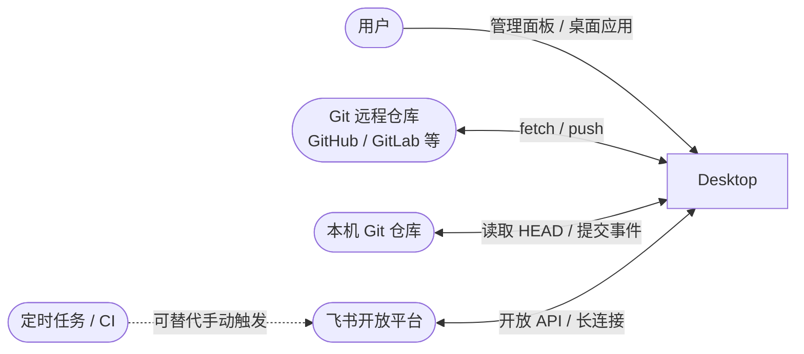
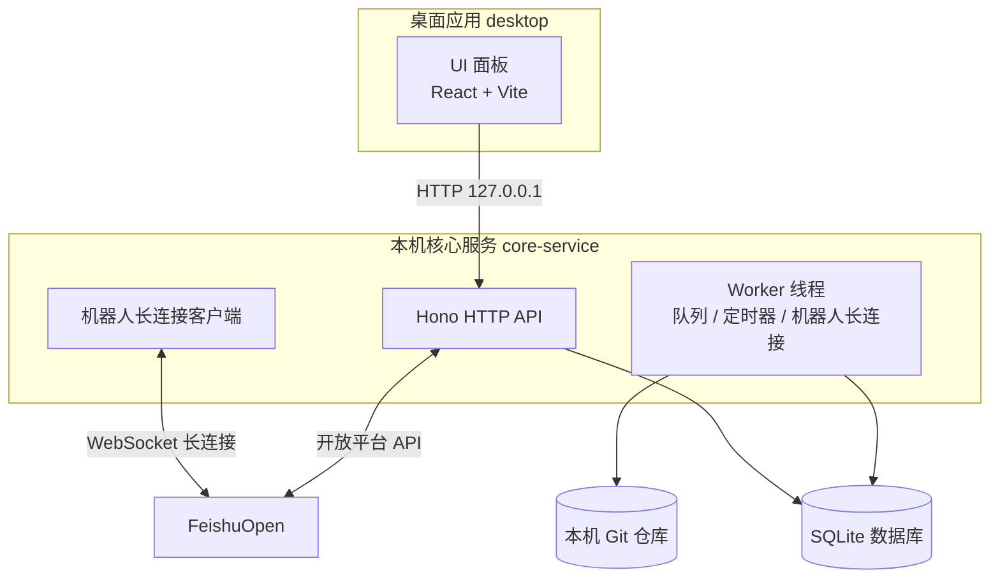
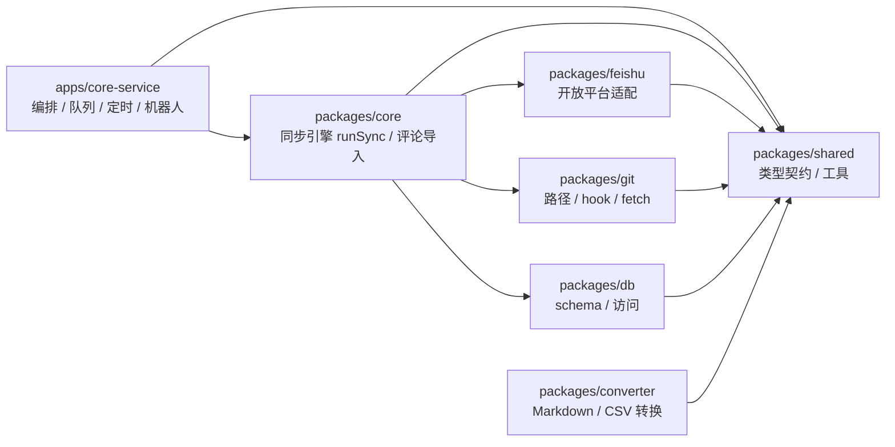

# 架构总览

- 状态：待校验
- 最后更新：2026-08-01

本文用 C4 模型分层描述系统架构：**Context（系统边界）→ Container（可部署单元）→ Component（模块/包）**。满足全部需求条目；容器布局来源 [需求总览](../01-需求/需求总览.md)。

## 1. Context 层：系统与外部实体

**系统边界**：系统本体是「Feishu MD Repo」本地应用。系统外实体包括：

| 实体 | 关系 | 说明 |
|------|------|------|
| 本机 Git 仓库 | 读取 | 同步源；本地库模式读 HEAD，安装提交 hook |
| Git 远程仓库 | 拉取 | 有云库模式先 fetch 再读远程分支 |
| 飞书开放平台 | 读写 + 事件 | Wiki/Drive 节点、docx 正文、画板、IM 消息、评论、删除事件 |
| 用户 | 操作 | 通过管理面板配置与观察 |

## 2. Container 层：可部署单元

| 容器 | 职责 | 技术 |
|------|------|------|
| desktop | Tauri 2 桌面壳，承载 UI | Tauri 2 |
| ui | 管理面板：仪表盘、绑定、日志、工具箱、设置 | React + Vite |
| core-service | 本机 API、同步/评论队列、定时器、机器人长连接、任务抢占 | Hono |
| db | 本地持久化 | Drizzle + SQLite |

**运行约束**：core-service 默认只监听 `127.0.0.1:8787`（[NFR-sec-02](../01-需求/非功能需求.md)）；凭证与映射只存本机 SQLite（[NFR-sec-01](../01-需求/非功能需求.md)）。

## 3. Component 层：包（package）划分

| 包 | 职责 | 关键模块 |
|----|------|----------|
| packages/core | 业务引擎 | `runSync`、`runCommentImport`、`sync/*`（planner / progress / repair）、`comment-import`、`errors` |
| packages/feishu | 飞书开放平台适配 | client、wiki/drive adapter、docx、board、image、table、comment、export、mermaid 渲染 |
| packages/git | Git 访问 | factory（local/cloud）、sync-paths、hooks |
| packages/converter | 文档格式转换 | markdown-to-feishu、csv-to-markdown |
| packages/db | 数据访问 | Drizzle schema、CRUD 函数 |
| packages/shared | 共享层 | 类型契约、api-contract、broadcast-policy、diagram 工具、logger |
| apps/core-service | 应用编排 | app、scheduler、sync-coordinator、comment-import-coordinator、bot/*、binding-task-* |

## 4. 同步进度阶段

同步主链路固定阶段：`planning → structure → content → cleanup → overview → done`（[R-sync-10](../01-需求/需求-同步.md)）。各阶段职责见 [设计-同步引擎](./设计-同步引擎.md)。

## 5. 关键横切设计

| 关注点 | 设计 | 关联 |
|--------|------|------|
| 可观测 | 健康检查含 `apiVersion` 与能力列表 | [NFR-obs-01](../01-需求/非功能需求.md) |
| 可靠性 | 队列 + 任务代际抢占 + 频控重试 | [设计-同步引擎](./设计-同步引擎.md) |
| 安全 | 本机监听、密钥本地化 | [NFR-sec-*](../01-需求/非功能需求.md) |

---
← [返回本目录](./README.md)
