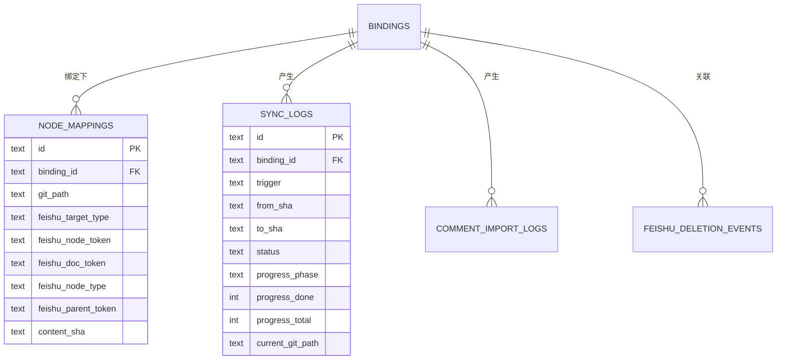

# 设计-数据模型

- 状态：待校验
- 最后更新：2026-08-01
- 覆盖需求：[需求-同步](../01-需求/需求-同步.md)、[需求-评论回流](../01-需求/需求-评论回流.md)、[非功能需求](../01-需求/非功能需求.md)

## 1. 表结构总览

数据存本机 SQLite（[ADR-001](./决策记录/ADR-001-本地优先与单机SQLite.md)），由 `packages/db` 的 Drizzle schema 定义。

## 2. bindings（绑定）

| 字段 | 类型 | 说明 |
|------|------|------|
| id | text PK | 绑定标识 |
| name | text | 显示名称 |
| source_type | enum | `local` / `cloud` |
| repo_path | text | 仓库路径 |
| remote_url | text | 有云库远程 URL |
| branch | text | 分支（默认 main） |
| sync_mode | enum | `workspace` / `repository` |
| feishu_target_json | text | 目标配置（Wiki/Drive）JSON |
| triggers_json | text | 触发配置 JSON |
| options_json | text | 模式选项 JSON |
| binding_broadcast_targets_json | text | 绑定级播报目标 JSON |
| bot_id | text | 指定机器人档案 ID |
| last_synced_sha | text | 最近同步 SHA |
| last_synced_at | text | 最近同步时间 |

## 3. node_mappings（节点映射）

| 字段 | 类型 | 说明 |
|------|------|------|
| id | text PK | 映射标识 |
| binding_id | text FK | 所属绑定（级联删除） |
| git_path | text | Git 路径（保留路径 `__sync_overview__` 除外） |
| feishu_target_type | enum | `wiki` / `drive` |
| feishu_node_token | text | 飞书节点 token |
| feishu_doc_token | text | 文档 token（docx 节点） |
| feishu_node_type | enum | `folder` / `docx` / `file` |
| feishu_parent_token | text | 父节点 token |
| content_sha | text | 正文哈希，用于增量跳过 |

## 4. sync_logs（同步日志）

| 字段 | 类型 | 说明 |
|------|------|------|
| id | text PK | 日志标识 |
| binding_id | text FK | 所属绑定 |
| trigger | enum | `git` / `schedule` / `manual` / `bot` |
| from_sha / to_sha | text | 变更前后 SHA |
| status | enum | `pending` / `running` / `success` / `failed` |
| progress_phase | enum | 五阶段 + done |
| progress_done / progress_total | int | 进度计数 |
| current_git_path | text | 当前处理文件 |

## 5. comment_import_logs（评论导入日志）

记录触发来源、状态、文档数/评论数/回复数、起止时间。

## 6. feishu_deletion_events（飞书删除事件）

记录飞书侧删除事件（file_token / file_type / event_type），关联绑定与映射，含接收与处理时间。

## 7. app_settings（应用设置）

KV 结构（key / value_json），存放飞书凭证、机器人配置、用户权限名单等。

## 8. 约束与约定

- 所有 `*_json` 字段存储序列化 JSON，内容由 `packages/shared` 的类型契约约束；
- 时间字段统一 ISO 8601 字符串；
- 外键级联删除保证绑定删除时清理关联数据。

---
← [返回本目录](./README.md)
